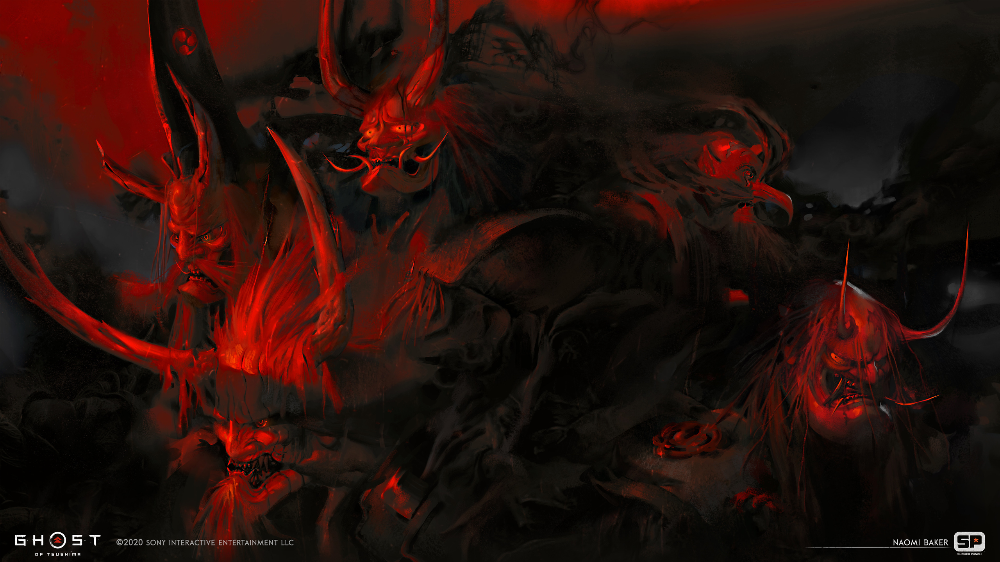

# Ghost of Tsushima — Omarchy Theme

An evocative, high-contrast samurai aesthetic theme for [Omarchy](https://omarchy.org), honoring the cinematic artistry and historical atmosphere of Sucker Punch's *Ghost of Tsushima*.



## Overview

The theme balances lacquer ink darkness (`#0C0E12`) with the deep crimson of blooming spider lilies (`#C1121F`), golden autumn ginkgo leaves (`#D4AF37`), and cold katana steel (`#4A6FA5`).

- **Base Atmosphere:** Dark Japanese lacquerware glass surfaces with subtle backdrop blur.
- **Accents:** Spider Lily Crimson focus states and borders with Ginkgo Gold hover blooms.
- **Borders:** Elegant Hyprland gradient transitioning between Blood Red, Ginkgo Gold, and Katana Blue.

## Wallpapers (Native 4K — 3840×2160)

Includes 12 curated, lossless native 4K wallpapers capturing the iconic moods of Tsushima:

1. **`01-golden-forest.jpg`** — Golden Temple and Kushihara ginkgo groves bathed in warm autumn sunlight.
2. **`02-spider-lily-field.jpg`** — The fateful duel amidst scarlet higanbana (spider lilies) under dark storm clouds.
3. **`03-ghost-in-the-shadows.png`** — Jin Sakai perched in the moonlit midnight bamboo, embodying the Ghost.
4. **`04-white-pampas-duel.jpg`** — Windblown white pampas grass duel fields with distant lanterns and mountain mist.
5. **`05-sakai-estate-blossoms.png`** — Cherry blossoms floating gently over the Sakai ancestral family estate.
6. **`06-burning-sunset-duel.jpg`** — Blazing amber and fiery gold sunset clash high above the coastal cliffs.
7. **`07-jin-sakai-katana-stance.jpg`** — Jin Sakai poised with drawn Sakai katana in full Ghost armor stance.
8. **`08-coastal-shrine-cliffs.jpg`** — Ancient Shinto shrine overlooking misty coastal cliffs and the crashing Pacific sea.
9. **`09-autumn-canopy-sunburst.jpg`** — Brilliant sunbeams cutting through the red and gold maple canopy.
10. **`10-misty-peaks-sanctuary.jpg`** — Sacred mountain sanctuary towering above morning cloud inversion layers.
11. **`11-crimson-dusk-clash.png`** — Cinematic duel silhouettes set against dramatic, blood-red dusk skies.
12. **`12-kurosawa-ghost-stance.jpg`** — Kurosawa cinematic high-contrast silver and shadow combat portrait.

## Color Palette

| Role | Color | Hex | Visual |
|---|---|---|---|
| **Background / Lacquer** | Ink Black | `#0C0E12` | ⬛ |
| **Surface / Card** | Dark Iron | `#151821` | 🔲 |
| **Accent / Focus** | Spider Lily Red | `#C1121F` | 🔴 |
| **Secondary Accent** | Ginkgo Gold | `#D4AF37` | 🟡 |
| **Tertiary Accent** | Katana Steel | `#4A6FA5` | 🔵 |
| **Foreground / Text** | Rice Paper White | `#E2E8F0` | ⚪ |

## Installation

### Method 1: Via Omarchy Theme Installer (Recommended)

```bash
omarchy-theme-install https://github.com/Mersad-Moghaddam/omarchy-ghost-of-tsushima-theme
```

Or switch directly once cloned:

```bash
omarchy theme set ghost-of-tsushima
```

### Method 2: Manual Clone / Script

```bash
git clone https://github.com/Mersad-Moghaddam/omarchy-ghost-of-tsushima-theme.git ~/.config/omarchy/themes/ghost-of-tsushima
omarchy theme set ghost-of-tsushima
```

## Cycling Wallpapers

Cycle through all 12 4K wallpapers anytime with:

```bash
omarchy theme bg next
```

Or bind it to your Hyprland keybinds (`Super + Ctrl + W`).

## Included Configurations

- **`colors.toml`** — Comprehensive ANSI & semantic color role definitions.
- **`shell.toml`** — Quickshell status bar styling with lacquer glass transparency and crimson selection bar.
- **`hyprland.conf`** — Window border gradients, rounded corners, and soft dropshadows.
- **`hyprlock.conf`** — Matching lock screen colors.
- **`swayosd.css`** — On-Screen Display styled with gold accent icons and crimson progress gradients.
- **`walker.css`** — Application launcher styling.
- **`btop.theme`** — Btop system monitor theme with CPU/Memory/Network color maps.
- **`cava_theme`** — CAVA audio visualizer color gradient.
- **`gtk.css`** & **`colors.css`** — GTK3/GTK4 color styling.
- **`icons.theme`** — Configured for `Yaru-red-dark`.

## Credits & License

- Designed for Omarchy by Mersad Moghaddam.
- Imagery based on *Ghost of Tsushima* by Sucker Punch Productions & Sony Interactive Entertainment.
- MIT License.
